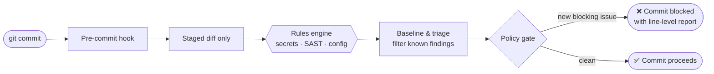

<div align="center">


# KYN

### High-speed, offline-first security tooling.

**Built to protect the pack. No bloat. No telemetry. Just pure local defense.**

<br/>


<br/>

[**Flagship**](#-flagship-commitguard) ·
[**Quick start**](#-quick-start) ·
[**How it works**](#-how-it-works) ·
[**Toolbox**](#-the-toolbox) ·
[**The Kyn code**](#-the-kyn-code) ·
[**Contribute**](#-join-the-pack)

</div>

---

## 🐺 Why Kyn exists

Most security tooling asks you to **send your code somewhere**, **run a stack to host it**, or **trust a score you can't reproduce**.

Kyn builds the opposite: small, fast instruments that run **on your machine**, work with the **network unplugged**, and tell you **exactly why** they said what they said.

> A scanner that runs *before* the commit is a habit.
> A scanner that runs *after* the incident is a postmortem.

---

## 🛡️ Flagship: CommitGuard

<table>
<tr>
<td width="62%" valign="top">

**[CommitGuard](https://github.com/KynSec/CommitGuard)** is an offline security gate for your git workflow. It inspects the code you are about to commit and stops hardcoded secrets, risky patterns, and misconfigurations **before they ever enter history**.

- 🔐 **Secrets** — API keys, tokens, and credentials in the staged diff
- 🧬 **SAST** — local, rule-based detection of insecure code patterns
- 🏗️ **Misconfiguration** — Dockerfiles, Terraform, YAML, shell
- 📦 **Dependencies** — offline OSV snapshot lookups for pinned versions
- 📑 **Reports** — Markdown, JSON, SARIF, JUnit, GitLab Code Quality, Checkstyle, HTML
- 🖥️ **Local control center** — a loopback-only GUI, never a hosted service
- 🧾 **Baselines & triage** — adopt it on a legacy repo without drowning in noise

</td>
<td width="38%" valign="top">

```text
$ commit-guard scan --staged

  diff-first   ✔
  offline      ✔
  telemetry    none
  exit codes   0 pass
               1 gate failed
               2 config/op error
```

<sub>Illustrative summary, not literal output.</sub>

</td>
</tr>
</table>

### Measured, not marketed

Every number below was measured from the CommitGuard **2.1.0** working tree on 2026‑10‑24. We publish what the tool does today — and what it doesn't yet.

| | |
|---|---|
| **Active rules** | 340 (239 are secret rules) |
| **Test suite** | 194 tests, passing |
| **Report formats** | 7 |
| **Local GUI** | 9-tab loopback control center |
| **Telemetry** | none |
| **Network required** | no |

> **Honest status:** CommitGuard today is a strong local secret and regex scanner with excellent reporting. It is **not yet** a full SAST platform — the 3.x roadmap closes that gap in public, with benchmark cards behind every claim.

---

## ⚡ Quick start

```bash
# 1. get it
git clone https://github.com/KynSec/CommitGuard.git
cd CommitGuard

# 2. install the pre-commit hook into any repo
commit-guard install

# 3. scan what you're about to commit
commit-guard scan --staged
```

<sub>`cg` is the short alias for `commit-guard`. Package-manager install (`pipx install commit-guard`) lands with the 3.0 release.</sub>

---

## 🔬 How it works



**Diff-first** means it scans what changed — not your whole repo — so the gate stays fast enough to keep on.

---

## 🧰 The toolbox

Small tools that each do one job well, share the same philosophy, and compose.

| Tool | What it does | Status |
|---|---|---|
| 🛡️ [**CommitGuard**](https://github.com/KynSec/CommitGuard) | Offline pre-commit security gate: secrets, SAST, misconfig |  |
| <!-- 🔧 [**ToolName**](https://github.com/KynSec/ToolName) --> `…` | <!-- one-line description --> Developer tooling in the works |  |

---

## 🧭 Where CommitGuard is going

<details>
<summary><b>CommitGuard 3.x roadmap</b> (click to expand)</summary>

<br/>

| Phase | Focus |
|---|---|
| **Hygiene** | License, security policy, provenance for every bundled rule pack, CI |
| **MVP** | Engine protocol, unified finding schema, policy-as-code, SARIF ingest, benchmark harness |
| **Credible 3.0** | Optional Semgrep/Opengrep engine, expanded taint analysis, language server, PR fix suggestions, deeper dependency scanning, SBOM, signed releases |
| **Category tool** | IaC and container coverage, compliance packs, plugins, multi-repo views |

**The target:** one policy, one baseline, one report, one exit code across every analyzer you already run — with no code leaving your machine.

</details>

---

## 📜 The Kyn code

| | Principle | What it means |
|---|---|---|
| 🔌 | **Offline by default** | If it needs the internet to protect you, it's not defense. Network access is opt-in, never assumed. |
| 🙈 | **Zero telemetry** | We don't watch you. Not anonymized, not aggregated, not at all. |
| ⚡ | **Fast enough to keep on** | A slow gate gets disabled. Speed is a security feature. |
| 🎯 | **Deterministic & explainable** | Same input, same result, and every finding says why. |
| 🧪 | **Claims need evidence** | Dataset, version, command, metric, limitations. No benchmark card, no claim. |
| 🪶 | **No bloat** | No server to host, no database to run, no account to create. |

---

## 🤝 Join the pack

- 🐛 **Found a bug or a false positive?** Open an issue — false-positive reports are product feedback, not noise.
- 💡 **Have a rule or an integration idea?** Start a discussion or send a pull request.
- 🔒 **Found a vulnerability in one of our tools?** Please report it privately through the repository's **Security → Report a vulnerability** tab rather than a public issue.
- ⭐ **Like what we're building?** A star helps other developers find it.

<br/>

<div align="center">

**Run it before the commit. Not after the incident.**

<sub>Kyn · Egypt · built for developers who'd rather not trust a black box</sub>

</div>
